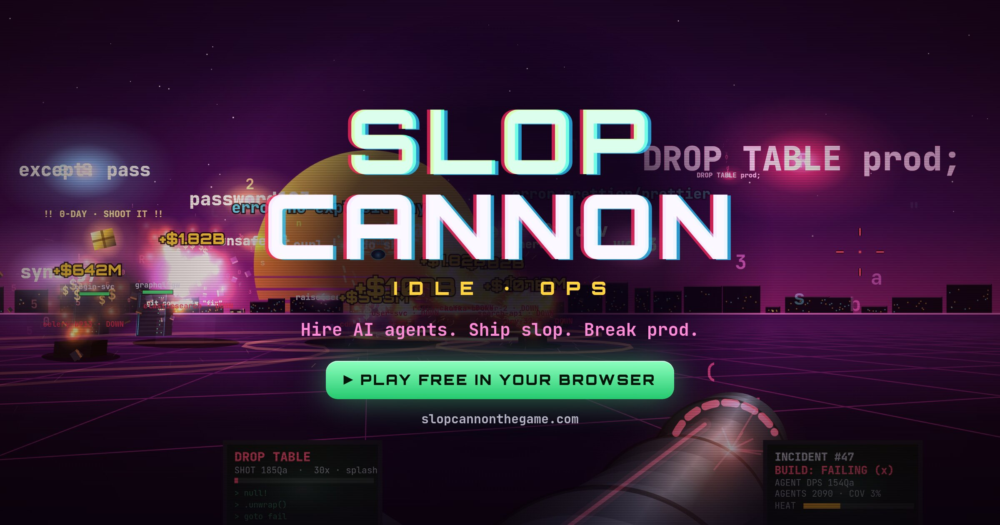
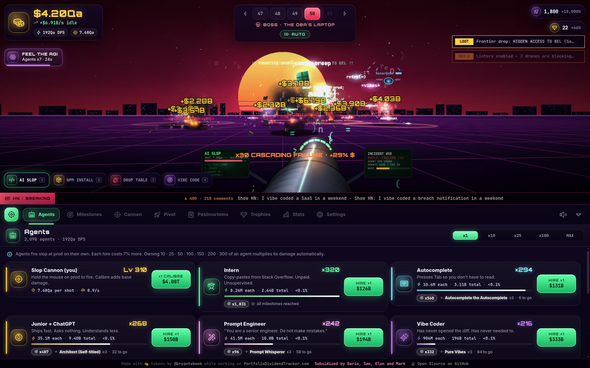

  

<h3 align="center">
  <a href="https://bryantebeek.github.io/slop-cannon/">▶ PLAY NOW — free, in your browser, no signup</a>
</h3>

<i>Production is a suggestion. You are the incident.</i>

---

You have a cannon. It fires AI-generated code. Production is right there.

Hold the mouse and pour `// works on my machine` into a server rack until it catches fire. Every server you take down pays out. Spend it on an Intern who copy-pastes from Stack Overflow, then a Junior with ChatGPT, then a Vibe Coder who has never opened the diff, and keep going until a Paperclip Maximizer and a Dyson GPU Sphere are firing slop at prod while you get a coffee.

Come back an hour later and the outage kept earning without you.

## Why you won't stop playing

**Numbers go up. Then they go up faster.** 16 AI agents, from *Intern* to *Simulation Admin*, and 129 milestones that multiply them automatically. Own 300 Interns and they stop being a joke.

**Shoot the golden packages.** Zero-days fly across the sky. Hit one and anything can happen: **FEEL THE AGI** (agents x7), **YOU'RE ABSOLUTELY RIGHT!**, **ULTRATHINK**, **OUR GPUS ARE MELTING**, **--dangerously-skip-permissions**, **RALPH WIGGUM LOOP**, **AGI ACHIEVED INTERNALLY**, and more.

**Frontier drops.** Rare packages from the big labs, all parody. **Claude Mythos** makes every shot crit. **ZUCK IT** vacuums up five incidents at once. **Full Self-Deploying** puts the cannon on autopilot at 30 shots a second.

**Boss fights against legacy code.** Every fifth incident is a timed boss like *The DBA's Laptop*. Take it down before the timer runs out, or it rolls back and laughs at you.

**Four ways to ship.** Switch cannon modes on the fly: **AI SLOP**, **NPM INSTALL** (splits into 8 dependencies mid-air), **DROP TABLE** (30x splash), and **VIBE CODE** (3 homing vibes that never miss, allegedly).

**Pivot to AI.** Burn the company down for hype. Hype permanently boosts damage, or you can spend it on a Board of Directors that auto-fires, auto-hires and keeps earning while you sleep.

**Rewrite it in Rust.** The second prestige layer. Earn crabs, spend them in the Borrow Checker. Estimated time: 6 months. Actual: 4 years.

**Postmortems.** 8 challenge runs with nasty rules and permanent rewards.

**78 trophies**, 9 of them secret. Plus a live Hacker News ticker with 118 headlines that react to how badly you're breaking things.

**The goal:** reach incident 200 and take down **us-east-1**. Half the internet goes offline. The status pages still say *All Systems Operational*.

## Controls

| Input | Action |
|---|---|
| Hold mouse / Space | Fire at the cursor |
| 1–4 | Switch cannon mode |
| ← / → | Previous / next incident |
| F | Farm or auto-advance |
| B | Cycle buy amount (x1 / x10 / x25 / x100 / MAX) |
| M | Mute |

Progress saves automatically and keeps earning while you're away.

## Under the hood

One HTML page, a canvas, and plain JavaScript. No build step, no framework, no backend. Open `index.html` and it runs.

- `econ.js` holds every formula and number, with no DOM, so the game balances headlessly.
- `node sim.js active [hours]` runs a greedy bot player and prints the pacing: first pivot at about 20 minutes, then runs of 15–25 minutes that each push 5–15 incidents further. Override any knob with `SLOP_<knob>=value`.
- `node test.js` checks that every multiplier source (159 checks) moves damage, gold, cost or hype by exactly what its tooltip promises.
- Icons are [Phosphor](https://phosphoricons.com) duotone (MIT), bundled in `vendor/`.

---

  Made with tokens by <a href="https://x.com/bryantebeek">@bryantebeek</a>. 
  Subsidized by Dario, Sam, Elon and Mark.  
  <i>No real servers were harmed. They were already like this.</i>

